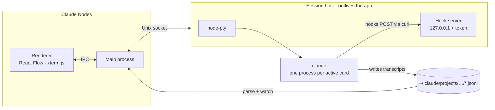

# How Claude Nodes works

The details behind the [README](../README.md): what the app runs, where status comes from, every shortcut, and how to work on the code.



## Sessions

Sessions are ordinary Claude Code sessions. New cards run `claude --session-id <uuid>`, and resuming runs `claude --resume <id>`, so you can continue the same session from any terminal later. Your own settings, hooks and MCP servers still apply.

## Sessions keep running after you quit

The app doesn't run sessions itself. A background process, the session host, owns their terminals, so quitting Claude Nodes (or a crash) leaves them running. Open the app again and the cards are still live, with their recent output and an up-to-date status.

The host starts with the first session you open, and runs Claude Nodes' own binary as plain Node, so it has no Dock icon. It also receives the sessions' hooks, and keeps them along with the keypresses that move status (Esc, Ctrl+C, Enter and number keys), so a relaunched app can work out each session's status. The host exits by itself once no sessions are left and the app isn't open. **Quit and Stop Sessions** (⌥⌘Q) stops every session along with the app.

## Terminal cards

Terminal cards run `$SHELL -l` in the repo folder with your login-shell environment. They get no hooks and have no transcript, so they have no status dot. A terminal whose shell has exited starts a fresh shell when you reopen it.

## Expanded cards

A card can expand in place to show its terminal on the board, so you can watch several sessions at once. It's the same terminal as the modal's, so moving between the two keeps the screen. Drag a card's edges or corners to resize it. The board saves each card's size and whether it's expanded. After a restart, an expanded card whose session is still running shows its terminal right away. One whose session has stopped waits for you to click **Resume session** or **Start shell** before it starts anything.

## Status

Status comes from hooks that the app adds for its own processes with `--settings`. Each hook POSTs its payload to a token-protected server on 127.0.0.1, run by the session host:

| Hook | Status |
| --- | --- |
| `UserPromptSubmit`, `PreToolUse`, `PostToolUse` | 🟠 Working |
| `PermissionRequest`, `Notification` (permission or question), `PreToolUse` for `AskUserQuestion` | 🔴 Needs you |
| `Stop`, `SessionEnd`, process exit | 🔵 Done |

Interrupting with Esc or Ctrl+C doesn't fire a hook, so the app watches for those keystrokes as well.

Hooks that fire inside a subagent carry its `agent_id`. Those drive the agent's own status instead (`SubagentStart` and its tool hooks for working, `SubagentStop` for done), and a card reads as working or needing you while any of its agents does.

## Agents

When Claude starts agents with its Agent tool, Claude Code keeps each one's transcript beside the session's, in `<session id>/subagents/agent-<id>.jsonl`, with a `.meta.json` holding its type and the description Claude gave it. The app watches those files.

The agents of the current run (still running, or finished since your last prompt) peek out from under the session's card as a deck, each layer in its status colour. Point at the deck, or the agent count in the card's footer (the 🤖 button in an expanded card's title bar), to fan the agents out beside the card with what each is doing. Click to pin the fan open. Click an agent for the agents viewer: every agent the session has started, with the selected one's task, tool calls and replies, updating while it works. Right-click a card and choose **Agents** to open the viewer for an archived session.

An agent that ends its turn with a command still running in the background isn't done: the command wakes it again when it finishes, so it stays 🟠 meanwhile.

## Notes

Each board has a pad of sticky notes under the archive, and it moves with the archive. Drag the top note off the pad and drop it anywhere on the board, or click the pad for one beside it. A new note opens for writing. Enter starts a new line, and Escape, ⌘Enter or a click away puts the note down. Double-click a note (or select it and press Enter) to write in it again. Drag it to move it, and drag a selected note's corners to resize it. Right-click it to change its colour or delete it. Deleting a note that has writing on it asks first.

Notes sit on top of cards. They don't join sections or the archive: a note dropped on the archive or the pad goes back where it was.

Point at a note with writing on it and press ▶ in its corner (or right-click it and choose **Start session**) to start a Claude session with the note's text as its first prompt, and nothing added. The card takes the note's place and gets to work there, without opening its window. The note then rides on the card as a sticker, a reminder of what was asked: point at it to read all of it, and press its × to delete it. That doesn't ask first, since the text lives on as the session's first prompt. An archived card keeps its sticker out of sight until it's restored. A card removed from the board drops its note back onto the board where the card was.

Claude writes notes too. Ask a session to do some research and put what it found on the board, and it writes notes with its board tools (below). They go up beside its card, one under another, sized to fit what they say, and signed with the session's name: click the name to open the session. Claude can also read the notes on the board and rewrite them, but not delete them.

## Board tools

Every Claude session started from the app gets an MCP server named `claude-nodes`, through `--mcp-config`, with tools for its board: `create_note`, `update_note` and `list_notes`. Action runs get `list_sessions` and `archive_sessions` as well. They're allowed with `--allowedTools`, so they never stop to ask.

The server lives in the session host, next to the hook server, and passes each request on to the app. So a session keeps its tools when you quit and reopen the app; while the app is closed, a tool call fails and says why. Every process gets the same config, and Claude Code fills in the host's port and token, and the session's id, from the process's environment, so the token never shows up in a process listing. Sessions started outside the app don't get the tools.

## Voice prompts

The mic button sits above the minimap, in the board's bottom-right corner. Click it (or press **V**) and talk: it turns red and swells with your voice, beside a clock and a level meter. Click it again (or press **V**) to stop, or press Esc to throw the recording away. A click shorter than about half a second is ignored, and a recording stops by itself after five minutes.

The recording goes to xAI's speech to text (`grok-voice-transcribe-2.0`), and what you said opens in a box for review. Edit it if you like, then press Enter (or **Start session**) to start a Claude session on it. Shift+Enter starts a new line, and Esc or **Discard** throws it away. **Keep talking** records more and adds it to the end. The session starts like one from a note: its card lands in a free spot in view and gets to work there, with your words on it as a sticker. If the session can't start, they're left on the board as a note.

Each recording goes with up to 100 hint words, so code names come back spelled as in the repo: the project's name, its branch and the names of the files it has changed. If xAI can't transcribe a recording, it's kept, and **Retry** sends it again.

The xAI API key comes from Settings or from `XAI_API_KEY` in your shell, and a saved one wins. Settings encrypts it with the macOS Keychain before it goes into `state.json`, and it never leaves the main process: the window only learns where the key comes from. With no key, the mic button opens Settings. The first recording asks macOS for the microphone. If you turned it down, the notice links to Privacy & Security › Microphone.

Audio leaves your machine only when you stop a recording, and goes to xAI alone. It counts toward your xAI usage.

## Cards

Cards are read from Claude Code's transcripts in `~/.claude/projects/<encoded-repo-path>/`. Titles use your custom title first, then Claude's generated title, then the first prompt. Parsing is incremental and cached, so large histories load quickly.

## New session from context

For each selected session the app runs `claude -p --resume <id> --fork-session --no-session-persistence`, at most three at a time. The fork writes a handoff summary and is then thrown away, so the original session is never touched. You review and edit the combined summaries, and they become the new session's first prompt.

This makes one Claude request per selected session, so it counts toward your Claude usage like any other prompt.

## Actions

A project's buttons live in a rail on the board's right edge. It hides like the project rail on the left: point at the window's right edge to slide it in. A project starts with none. The **+** button asks what a new one should do, with a few examples to start from. Claude (`claude -p`, Sonnet, able to read the repo but not change it) drafts a name, an icon and the prompt each press runs, and you review and edit them before saving. Right-click a button to run, edit or delete it.

Turn on **Use in every project** to make a button global: it shows in every project's rail, below that project's own buttons, with a globe on its tile. Claude then writes its prompt to work in any repository, finding commands at run time rather than assuming this one's. Turning the switch off moves the button into the project you're in. A project's buttons are stored with it in `state.json`, global ones at the top level of the same file, and never in the repo.

Pressing a button starts a session on the action's prompt. It isn't drawn on the board. Its button turns orange, and while the rail is out the session fans out beside it with what it's doing, so you can click to open it. While the rail is hidden, a sliver on the right edge shows a run is going, and turns red when one needs you. The run gets:

- `--permission-mode auto`, so it never stops to ask permission: Claude Code approves routine steps itself and blocks risky ones.
- the session tools, `list_sessions` and `archive_sessions`, on top of the note tools every session has (see [Board tools](#board-tools)).
- a note asking it to work without stopping to chat, to ask with AskUserQuestion when it needs you, and to end with a one-line summary.

When the run's turn ends, the session goes, its transcript is hidden like a removed card's, and the summary shows as a notice. If you type into a run, or interrupt it with Esc or Ctrl+C, it becomes yours: it joins the board as an ordinary session, and loses its session tools. Answering a question it asked doesn't count. While a run is going, pressing its button opens it rather than starting another.

## Your data

Transcripts stay where Claude Code keeps them. The app stores only the board layout (projects, card positions, sections, notes, archive, custom titles and lineage) and its settings (theme, and the xAI key for voice prompts if you save one, encrypted with the macOS Keychain) in `~/Library/Application Support/Claude Nodes/state.json`. *Remove from board* hides a card and never deletes a transcript.

The session host keeps its socket and log in the `host` folder next to it. Only your user can open the folder, which matters because anything that can connect to the socket can start processes as you.

## Shortcuts

| Where | Action | Shortcut |
| --- | --- | --- |
| Anywhere | Add a project | ⌘⇧N |
| | Settings (theme: System, Light or Dark) | ⌘, |
| | Quit and stop every session | ⌥⌘Q |
| | Close the modal, or go back to projects | ⌘W |
| Projects | Open the selected project | Double-click · ⌘O · ⌘↓ |
| | Rename · remove | Enter · ⌘⌫ |
| | Color, Reveal in Finder | Right-click |
| Board | New session | N · ⌘N · double-click empty canvas |
| | New terminal in the project folder | T · ⌘T |
| | Open a card | Click · Enter |
| | Expand a card on the board, or collapse it | E · the card's ⤢ button |
| | Resize an expanded card | Drag its edges or corners |
| | Select | Drag on empty canvas · ⇧-click · ⌘-click · ⌘A (all active) |
| | Group the selection into a section | ⌘G |
| | Archive the selection | ⌫ |
| | Search the archive | Hover the stack and type · Esc |
| | Rename a card | Double-click its title |
| | New note | Drag one off the pad under the archive · click the pad · right-click › New note here |
| | Write in a note | Double-click it · Enter |
| | Start a session from a note | Its ▶ button · right-click › Start session |
| | Speak a prompt · stop | V · the mic button above the minimap |
| | Start a session on what you said · discard it | Enter · Esc |
| | Delete the selected notes | ⌫ |
| | Fan out a card's agents | Point at the deck under it · click to pin |
| | Pan · zoom | Two-finger scroll, Space-drag or middle-drag · pinch |
| Terminal | Newline in Claude's prompt | ⇧Enter |
| | Clear · copy · select all | ⌘K · ⌘C · ⌘A |
| New session from context | Start | ⌘Enter |

In the terminal, Esc goes to Claude (it interrupts a turn), so it never closes the modal. ⌘W never closes the window.

## Known limitations

- Status is tracked only for sessions started from the app. A session running in another terminal shows as done.
- Running `/clear` inside a card starts a new session id, which shows up as a new archived card.
- In a repo Claude Code hasn't opened before, the first session shows Claude's folder-trust prompt. "No, exit" is preselected, so move to "Yes" before pressing Enter.
- If you update the app while sessions are running, and the update changed how the app talks to the session host, the new version asks to stop those sessions before it continues.
- A session host started by a version without board tools keeps running sessions after an update, but sessions started on it don't get the tools. They do once every session has stopped and a new host starts.
- Built and tested on macOS only.

## Project layout

```
src/
  shared/       types.ts + api.ts: the typed IPC contract (window.api)
                geometry.ts: board sizes and the free-spot search, which the main process uses to place notes
  preload/      contextBridge implementation of the contract
  main/         Electron main process
    env.ts        login-shell environment and claude binary lookup
    discovery.ts  parses transcripts into card metadata and watches for changes
    agents.ts     subagent transcripts: what each agent is doing, and its status
    board.ts      merges sessions on disk with the saved board; archive layout
    pty.ts        the app's side of the session host: output buffers replayed into terminals, input, status replay
    host.ts       the session host, a separate process: node-pty processes, the hook server and the board tools' endpoint
    hostProtocol.ts  messages between the two over a Unix socket
    hooks.ts      the status machine, driven by hooks the session host passes on
    summarize.ts  forked, non-persisted handoff summaries
    actions.ts    the actions rail's buttons: drafting them with Claude, and each run's extra claude options
    boardTools.ts the board tools' MCP server, answering what the session host relays: notes for every session, and listing and archiving sessions for action runs
    notes.ts      notes sessions write: where they go on the board, and how big they are
    voice.ts      speech to text for the mic button through xAI, and the key it uses
    store.ts      state.json in the app's userData directory
  renderer/src/
    views/        ProjectsView (folders) and BoardView (canvas)
    components/   title bar, folder icon, board cards, agent decks, sections, archive stack, notes and their pad, merge dialog, lineage edges, the mic button
    terminal/     xterm.js registry, TerminalModal, TranscriptPreview, AgentViewer
```

Built with Electron, electron-vite, React, TypeScript, [React Flow](https://reactflow.dev), [xterm.js](https://xtermjs.org), [node-pty](https://github.com/microsoft/node-pty) and zustand.

## Development

You need macOS, [Node.js](https://nodejs.org) 22+ and [pnpm](https://pnpm.io).

```sh
pnpm install
pnpm dev          # run with hot reload
pnpm build        # production build into out/
pnpm start        # run the production build
pnpm typecheck    # type-check main, preload and renderer
pnpm dist         # build the arm64 and x64 DMGs into dist/
```

`CLAUDE_NODES_USER_DATA=/some/dir pnpm dev` keeps app state separate from your real board, which is useful for testing. It gets its own session host too.

A running session host keeps the code it started with. After changing `host.ts`, use **Quit and Stop Sessions** so the next session starts a fresh host. Bump `PROTOCOL` in `hostProtocol.ts` whenever a message changes shape.

`pnpm dist` writes `dist/Claude-Nodes-arm64.dmg` and `dist/Claude-Nodes-x64.dmg`, with the unpacked apps in `dist/mac-arm64/` and `dist/mac/`. The apps are ad-hoc signed and not notarized, so a downloaded copy needs **Open Anyway** in Privacy & Security on first launch. The packaged app shares its board with `pnpm dev`, so don't run both at once.

### Releasing

Pushing a `v*` tag runs `.github/workflows/release.yml`, which builds both DMGs and attaches them to the GitHub release for that tag. The README's download links point at `releases/latest/download/`, so they pick up each new release.

```sh
npm version 0.2.0       # bumps package.json, commits, tags v0.2.0
git push --follow-tags
```

The workflow fails if the tag doesn't match the version in `package.json`.

### Troubleshooting installs

- **Wrong Node version.** Node 20 breaks Electron's installer and makes pnpm skip Vite's native binding. If a build fails with "Cannot find native binding", switch to Node 22 and run `rm -rf node_modules && pnpm install`.
- **`posix_spawnp failed`.** pnpm drops the execute bit on node-pty's `spawn-helper`. `scripts/postinstall.cjs` restores it, and also downloads Electron's binary, because pnpm 10 skips dependency build scripts. Run `pnpm install` again if either step was skipped.
